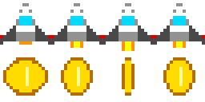
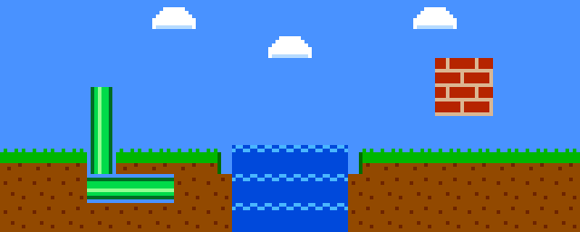
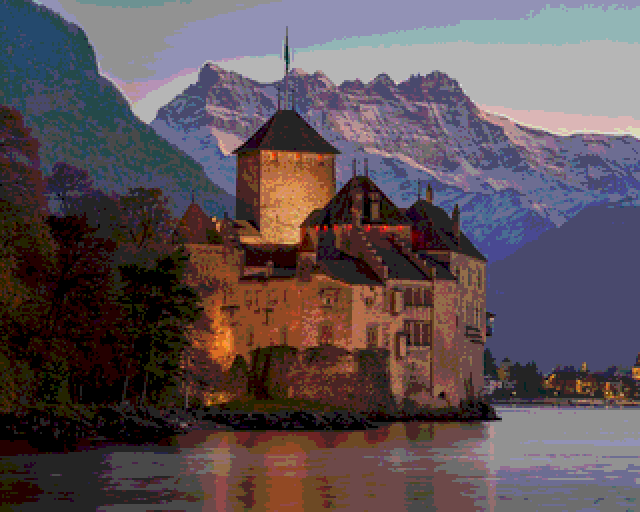
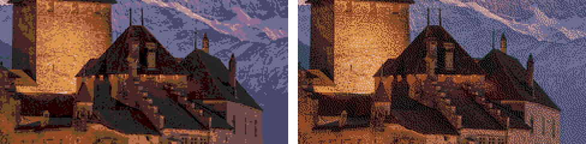
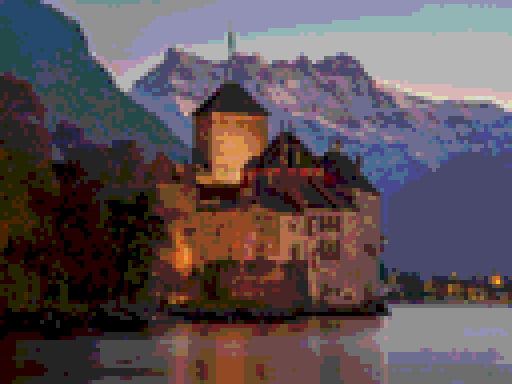
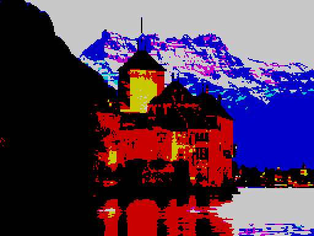
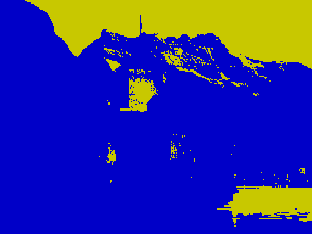

# Spectrum Next data with zentools

This manual covers `zx next` and `zx zx0`: palettes, sprites, Layer 2 and
LoRes screens, tiles and tilemaps, Timex screens, ZX0 compression, and
NEX files. It works through making the graphics for a small game and
packing them into a NEX file. It doesn't repeat the full flag reference,
which is in the [CLI manual](CLI.md#zx-next).

For classic `.scr` screens and the ZXMODE modes, see the
[sprite handling](SPRITE-HANDLING.md) and
[ZXMODE handling](ZXMODE-HANDLING.md) manuals.

## Contents

- [The tutorial assets](#the-tutorial-assets)
- [Next colour in brief](#next-colour-in-brief)
- [A title screen in Layer 2](#a-title-screen-in-layer-2)
- [Palettes](#palettes)
- [Sprites](#sprites)
- [Sprite attributes](#sprite-attributes)
- [Tiles and tilemaps](#tiles-and-tilemaps)
- [LoRes and Timex screens](#lores-and-timex-screens)
- [Compressing with ZX0](#compressing-with-zx0)
- [Packing a NEX file](#packing-a-nex-file)
- [Reference notes](#reference-notes)

## The tutorial assets

The sprites and the tile level were drawn for this manual, and anyone may
use them. The title screen is Giles Laurent's photograph *Chateau de
Chillon and Dents du Midi*, licensed under
[CC BY-SA 4.0](https://creativecommons.org/licenses/by-sa/4.0/); the
screens made from it here are adaptations shared under the same
licence. The [ZXMODE manual](ZXMODE-HANDLING.md#the-pictures) says where
to get it as `chillon.jpg`.



*`sprites.png`, 64x32 pixels with a transparent background, shown at
four times its size. The top row has four frames of a ship and the
bottom row four frames of a coin. The fourth ship frame repeats the
second, and so does the fourth coin frame.*



*`level.png`, 160x64 pixels (20x8 tiles of 8x8), shown at four times its
size. It is built from a few tiles, some of them mirrored or turned
copies of others.*

## Next colour in brief

Every Next colour is 9-bit RGB333, with three bits each of red, green and
blue, so there are 512 colours. Layer 2, sprites and tiles show 8-bit
(or 4-bit) indices into a palette of such colours.

- A palette file has no header. The usual `.nxp` holds two bytes per
  colour. `zx` also reads and writes three other layouts used by other
  tools (see [Palettes](#palettes)).
- An 8-bit image channel becomes 3 bits by rounding to the nearest of
  the eight levels (`--round nearest`, the default). The other modes
  are `floor`, `ceil` and `distance`, which is gfx2next's default.
- Transparency is not an alpha channel. Layer 2, the ULA and LoRes treat
  a pixel as transparent when its colour matches the global transparency
  colour (NextReg 0x14, 0xE3 at reset). Sprites compare the pixel's
  index with NextReg 0x4B (0xE3 at reset; a 4-bit sprite compares only
  the low four bits, so 3). The tilemap compares its index with NextReg
  0x4C (0xF at reset). `--transparent n` gives pixels less than half
  opaque the index n, and stores n's RGB332 colour in that palette
  entry. With 0xE3, the same files work for Layer 2 and 8-bit sprites at
  their reset settings.
- The standard palette maps index i to the RGB332 colour i.
  `zx next palette std -o std.nxp` writes it.

An image becomes palette indices in one of four ways:

| Source | What happens |
| --- | --- |
| An indexed PNG or BMP | Its palette and indices are kept as they are, as gfx2next does. |
| `--match file.nxp` | Each colour becomes the nearest colour of an existing palette. |
| `--std` | Each colour becomes the nearest colour of the standard palette. |
| Anything else | If the image's colours fit after reduction to RGB333, they are kept in the order they first appear. Otherwise `zx` chooses the colours by median cut. |

## A title screen in Layer 2

Layer 2 is the Next's bitmap layer. It has three sizes, plus the
lower-resolution LoRes layer:

| `--mode` | Size | Bits per pixel | Stored | Bytes |
| --- | --- | --- | --- | --- |
| `256x192` | 256x192 | 8 | row by row | 49152 |
| `320x256` | 320x256 | 8 | column by column | 81920 |
| `640x256` | 640x256 | 4 | column by column | 81920 |
| `lores` | 128x96 | 8 | row by row | 12288 |
| `lores4` | 128x96 | 4 | row by row | 6144 |

`zx scr fit` fits the photograph to 320x256 with the Lanczos filter.
`zx next bitmap encode` then writes the screen and its palette:

```
zx scr fit chillon.jpg --size 320x256 --resize fill --filter lanczos -o chillon-320.png
zx next bitmap encode chillon-320.png --mode 320x256 -o title.nxi --palette title.nxp
zx next bitmap decode title.nxi --palette title.nxp -o title.png
```

`bitmap encode` has its own `--resize`, but it has no Lanczos filter,
trim or centring, so fitting with `zx scr fit` first gives a better
picture.



*The 320x256 Layer 2 screen, shown at twice its size. The steps in the
evening sky are the limit of three bits per channel.*

`bitmap info` describes a screen file:

```
$ zx next bitmap info title.nxi
title.nxi: 320x256, 320x256 at 8 bits per pixel, column by column
  (640x256 at 4 bits is the same size; decode with -mode 640x256 for that)
  no embedded palette
```

The two 81920-byte modes can't be told apart by size, so `decode` takes
such a file as `320x256` unless `--mode 640x256` says otherwise. With
`--embed`, the palette is written before the pixels, 82432 bytes in all,
and `decode` finds it by the file's size.

**Colour depth and dithering.** This photograph's dusk colours reduce
to only 97 distinct RGB333 colours, so they all fit in the palette and none
has to be chosen. `--dither fs` has nothing to do here: dithering
applies only when an image's colours are matched or chosen. The steps
in the sky come from the 512-colour space itself, and `zx` does not
currently dither against them (the work register tracks this as T-09).

Dithering matters when the palette is too small for the picture. The
640x256 mode has 16 colours:

```
zx scr fit chillon.jpg --size 640x256 --resize fill --filter lanczos -o chillon-640.png
zx next bitmap encode chillon-640.png --mode 640x256 -o hi.nxi --palette hi.nxp
zx next bitmap encode chillon-640.png --mode 640x256 --dither fs -o hi-fs.nxi --palette hi-fs.nxp
```



*16 colours at 640x256, without dithering (left) and with `--dither fs`
(right). Measured as the ZXMODE manual describes, with `zx scr compare
--metric blur`, the error falls from 7.75 to 6.16.*

The standard palette needs no palette file, but it fits a picture less
well. `--std` gives the 320x256 Chillon an error of 14.25, against 6.81
with its own palette.

## Palettes

`palette info` lists a palette, and `palette decode` draws it as a
16x16 grid of swatches:

```
$ zx next palette info title.nxp
title.nxp: 256 colours (rgb333)
  0  RGB333 123  #24496D
  1  RGB333 122  #244949
  2  RGB333 245  #4992B6
...
zx next palette decode title.nxp -o title-palette.png
```

Other tools want other layouts, which `--layout`, `--from` and `--to`
name:

| Layout | Bytes per colour | Written by |
| --- | --- | --- |
| `rgb333` (default) | 2 | gfx2next and nextraw: the usual `.nxp` |
| `rgb332` | 1 | gfx2next `-pal-rgb332`; the hardware fills in the missing blue bit as the OR of the other two |
| `gbr444` | 2 | gfx2next `-pal-gbr444` |
| `bgr222` | 1 | gfx2next `-pal-bgr222`, the Master System layout |

```
$ zx next palette convert title.nxp --to rgb332 -o title.pal
wrote title.pal (256 colours, rgb332, 256 bytes)
$ zx next palette info title.pal --layout rgb332
title.pal: 256 colours (rgb332)
  0  RGB333 123  #24496D
  1  RGB333 123  #24496D
...
```

Colour 1 was RGB333 122. In one byte, its low blue bit is lost, and the
hardware shows the OR of the other two blue bits, so it comes back as
123. Colour 0's low blue bit was already that OR, so it survives.

`palette encode` takes or chooses an image's palette on its own, with the
colour flags above. `--min` sorts a palette, drops duplicates and
renumbers the pixels, as gfx2next's `-pal-min` does. It refuses to work
with `--transparent`, because sorting would move the transparent entry.

## Sprites

A `.spr` file is 16x16 patterns one after another: 256 bytes each at 8
bits per pixel, or 128 at 4 bits. `sprite encode` cuts an image into
patterns, left to right and top to bottom:

```
$ zx next sprite encode sprites.png --dedup --transparent 0xE3 -o sprites.spr --palette sprites.nxp
pattern 3 repeats kept pattern 1
pattern 7 repeats kept pattern 4
wrote sprites.spr (6 patterns, 1536 bytes)
wrote sprites.nxp (256 colours, rgb333, 512 bytes)
```

`--dedup` dropped the two repeated frames. Each message gives the
pattern's position in the image, then the number of the kept pattern it
repeats in the file. The animation table in your program should use the
file's numbers: ship frames 0, 1, 2, 1 and coin frames 3, 4, 5, 4. The
transparent background became index 0xE3.

```
$ zx next sprite info sprites.spr
sprites.spr: 6 patterns of 16x16 at 8 bits per pixel
  0  7 colours used
  1  8 colours used
...
zx next sprite decode sprites.spr --palette sprites.nxp --transparent 0xE3 --per-row 8 -o sheet.png
```


*`sprites.spr` drawn back, at four times its size: the six patterns left
after dropping the repeats.*

`decode --range 3-5` draws only some patterns, and `--split dir` writes
each one as its own PNG (`dir/000.png` onwards), which is handy for
checking frames one at a time. `--pad n` fills a sheet out to n patterns
with the transparent index, for a program that loads a fixed number.

**4-bit sprites.** At 4 bits per pixel, a pattern takes half the memory
and its 16 colours are one of the palette's 16-colour banks. This sheet
has 11 colours with the background, so it fits:

```
zx next sprite encode sprites.png --depth 4 --dedup --transparent 3 -o sprites4.spr --palette sprites4.nxp
zx next sprite decode sprites4.spr --depth 4 --palette sprites4.nxp --transparent 3 -o sheet4.png
```

That writes 768 bytes of patterns and a 16-colour palette of 32 bytes.
The transparent index is 3 because a 4-bit sprite compares only the low
four bits of NextReg 0x4B, which is 0xE3 at reset. A 4-bit pattern
stores its left pixel in the high nibble.

## Sprite attributes

The sprite hardware takes four or five attribute bytes per sprite
through port 0x57: position, pattern, palette offset, mirroring,
rotation and scaling. `attrs encode` builds that table from JSON, so it
can be edited and kept under version control. `attrs decode` turns a
table back into JSON.

```json
[
  {"x": 152, "y": 200, "visible": true, "pattern": 0},
  {"x": 40, "y": 60, "visible": true, "pattern": 3, "extended": true, "scale_x": 1, "scale_y": 1},
  {"x": 200, "y": 60, "visible": true, "pattern": 3, "extended": true},
  {"x": 20, "y": 0, "visible": true, "pattern": 4, "extended": true, "relative": true},
  {"x": 40, "y": 0, "visible": true, "pattern": 5, "extended": true, "relative": true}
]
```

```
$ zx next attrs encode sprites.json -o sprites.atr
wrote sprites.atr (5 sprites, 24 bytes)
```

This places the ship (pattern 0) at 152,200, and a coin at double size.
The last three sprites form a group: an anchor coin at 200,60, and two
relative sprites 20 and 40 pixels to its right. A relative sprite's `x`
and `y` are offsets from the last anchor, -128 to 127, so moving the
anchor moves the whole group.

Scaling, relative sprites, 4-bit patterns and some other fields live in
the fifth byte. `zx` refuses a sprite that needs it unless it sets
`extended`, so the table never silently drops a field. The first sprite
needs only four bytes, which is why five sprites take 24 bytes.
`--fixed5` writes five bytes for every sprite, for a program that
uploads the table with a fixed stride. `scale_x` and `scale_y` run from
0 to 3, for 1x to 8x. The [CLI manual](CLI.md#zx-next) lists every
field.

## Tiles and tilemaps

The tilemap layer draws a screen from a set of tiles and a map of tile
indices. `tiles encode` cuts an image into tiles (8x8 by default) and
writes three files from a base name: `base.nxt` holds the tiles,
`base.nxm` the map, and `base.nxb` the blocks, when there are any.

How many tiles are left depends on how far `--dedup` looks for matches:

| `--dedup` | Tiles from `level.png` | What else counts as a repeat |
| --- | --- | --- |
| `none` | 160 | nothing: every tile is kept |
| `repeat` | 11 | an identical earlier tile |
| `mirror` | 9 | also a mirrored one: the right half of each cloud and the left grass edge |
| `rotate` | 8 | also a turned one: the sideways pipe |

A mirrored or turned match costs no tile memory, because the map entry's
attribute bits draw the stored tile mirrored or turned. Those bits need
two-byte map entries, `--map16`. At 4 bits per pixel, the 8 tiles take
256 bytes:

```
$ zx next tiles encode level.png --depth 4 --colors 16 --dedup rotate --map16 -o level --palette level.nxp
wrote level.nxt (8 tiles of 8x8 at 4 bits, 256 bytes)
wrote level.nxm (20x8, 320 bytes)
wrote level.nxp (16 colours, rgb333, 32 bytes)
```

`--colors 16` is needed because a 4-bit tile set from an image that is
not indexed must not choose more colours than a bank holds. An indexed
image drawn in banks of 16 colours keeps its banks instead: each map
entry's palette offset comes from the high four bits of the tile's last
pixel, as gfx2next does.


*The tile set, at eight times its size, in the order the tiles first
appear in the level. The right half of the cloud, the left grass edge
and the sideways pipe are not stored; the map draws them from these.*

`tiles decode` draws the tile set as a sheet, or draws the map itself
with its attributes applied. Drawing the map is the check that nothing
was lost:

```
zx next tiles decode level.nxt --depth 4 --palette level.nxp -o tileset.png
zx next tiles decode level.nxt --depth 4 --palette level.nxp --map level.nxm --map-size 20x8 --map16 -o check.png
zx scr compare level.png check.png
```

The last command prints `0 of 10240 pixels differ`.

Like gfx2next, `zx` records every way a tile matches. A symmetric tile,
such as the plain sky, can therefore carry mirror bits in its map entry
although it is drawn the same either way.

Some other flags:
- `--map-columns` writes the map column by column.
- `--offset n` adds n to every tile index, for a tile set loaded after
  other tiles.
- `--pal-offset n` sets every entry's palette offset.
- `--block WxH` groups tiles into blocks, which the map then indexes.
  Blocks hold plain tile indices, so they work only with `--dedup none`
  or `repeat`.

## LoRes and Timex screens

**LoRes** is 128x96 at 8 bits per pixel (or 4 bits with `lores4`), with
the same palette handling as Layer 2:

```
zx scr fit chillon.jpg --size 128x96 --resize fill --filter lanczos -o chillon-128.png
zx next bitmap encode chillon-128.png --mode lores -o title.slr --palette lores.nxp
```



*LoRes, at four times its size.*

**Timex screens.** The Next also has the two Timex modes. Both files are
12288 bytes: the screens at 0x4000 and 0x6000, one after the other. The
size can't tell them apart, so `--mode` is always given.

- **HiColour** is 256x192 with an attribute for every 8x1 pixels instead
  of every 8x8. The encoder chooses each span's ink, paper and
  brightness for the least error.
- **HiRes** is 512x192 in a single ink colour (`--ink`, 0 to 7) and its
  complement as paper. From a full-colour image, a pixel darker than
  mid-grey becomes ink; an indexed image uses any index but 0 as ink.

```
zx scr fit chillon.jpg --size 256x192 --resize fill --filter lanczos -o chillon-256.png
zx next timex encode chillon-256.png --mode hicolour -o title.hic
zx scr fit chillon.jpg --resize fill --filter lanczos -o chillon-512.png
zx next timex encode chillon-512.png --mode hires --ink 1 --resize stretch -o title.shr
zx next timex decode title.hic --mode hicolour -o hic.png
```

A HiRes pixel is half as wide as it is tall, so a HiRes picture is fitted
at 512x384, the shape of the screen, and then squeezed to 512x192 with
`--resize stretch`. Fitting straight to 512x192 would crop a wide strip
of the picture and show it stretched upwards.



*HiColour, at twice its size. It still has two colours per 8 pixels
across, but each pixel row of a cell can have its own pair.*



*HiRes with ink 1 (blue) and its complement (yellow), shown with each
row doubled to keep the proportions. It suits line art and text better
than a photograph, especially a dark one: draw for it, or dither to one
bit before encoding.*

## Compressing with ZX0

`zx zx0` compresses in Einar Saukas's ZX0 format, which the Next tools
and many Spectrum programs decompress at run time. It is a port of the
reference compressor, with the same optimal parse, so it writes the same
bytes as `zx0`.

```
$ zx zx0 title.nxi
wrote title.nxi.zx0 (24757 bytes from 81920)
$ zx zx0 --quick title.nxi -o title-quick.nxi.zx0
wrote title-quick.nxi.zx0 (25343 bytes from 81920)
$ zx zx0 -d title.nxi.zx0 -o back.nxi
wrote back.nxi (81920 bytes from 24757)
```

The optimal parse takes time. Here it took 1 minute 57 seconds for the 80 KB screen.
`--quick` searches nearer offsets only, and took 4.6 seconds for 2% more
bytes. Use `--quick` while iterating and the full
search for a release.
- `--back` compresses backwards, for decompressing in place from the
  end of a buffer.
- `--classic` writes the older v1 format that gfx2next writes.

## Packing a NEX file

A NEX file holds a program's memory banks, a loading screen and its
palette, and a header with the start address. `nex build` puts one
together. Here, `game.bin` stands for a program assembled to run at
0x8000:

```
$ zx next nex build --bin 0x8000=game.bin --pc 0x8000 --sp 0xFF00 --screen l2_320=title.nxi --palette title.nxp --border 0 -o game.nex
wrote game.nex (NEX V1.3, 1 banks, 99328 bytes)
$ zx next nex info game.nex
game.nex: NEX V1.3
  start 8000, stack FF00, bank 0 at C000, border 0
  core 2.0.28 or later, 768 KB
  loading screen: l2_320, with palette
  1 banks: 2
```

- `--bin ADDR=file` loads a file at a 64 KB address. It goes into the
  banks that the Next maps there at start: 5 at 0x4000, 2 at 0x8000 and
  0 at 0xC000. `--bank N=file` places a file in any 16 KB bank directly,
  for data beyond the first 64 KB.
- `--screen` takes the loading screen. Its kinds are `l2`, `l2_320`,
  `l2_640`, `lores`, `ula`, `hires` and `hicolour`.
- A 320x256 screen needs NEX version V1.3, so `zx` raised the version by
  itself. Checksums, copper code and appended data (`--checksum`,
  `--copper`, `--append`) do the same.

`nex extract` takes a file apart, and `nex build --header` puts it back
together from those parts with changes:

```
$ zx next nex extract -o parts game.nex
wrote 4 files to parts
$ ls parts
bank_002.bin  header.json  palette.nxp  screen_l2_320.nxi
```

`header.json` holds the start address, stack, entry bank, border, core
version and the other header fields. `zx` lays out a NEX file as
sjasmplus's `SAVENEX` does. Its tests rebuild six files that sjasmplus
wrote, byte for byte.

## Reference notes

All the commands here are `zx next` and `zx zx0`. The full flag
reference is in the [CLI manual](CLI.md#zx-next), and the library API
(`pkg/zxn`, `pkg/nex`, `pkg/zx0`) in the [library manual](LIBRARY.md).
Points that are easy to miss:

- **The output matches the community tools.** Palettes, sprites, Layer 2
  bitmaps and tiles match gfx2next byte for byte, and Layer 2 also
  matches nextbmp and nextraw. With `--round floor` and `ceil`, gfx2next
  reduces a palette colour twice, so it moves one more step. `zx`
  reduces once, as nextbmp does.
- **Some layouts are not yet checked on hardware.** Sprite attributes,
  the Timex screens and 4-bit LoRes follow the Next's documentation, and
  haven't yet been checked on a Next or an emulator. The work register
  tracks this as T-04.
- **Transparency is set by NextRegs, not by the files.** Layer 2
  compares colours with NextReg 0x14, sprites compare indices with 0x4B,
  and the tilemap compares indices with 0x4C. A program that changes
  those registers needs files encoded to match. Decoding with
  `--transparent` only shows which index a file uses.
- **gfx2next options not in `zx`.** Tile cutting in column order, planar
  4-bit tiles, splitting output into bank files, and assembler or C
  output are not in `zx next`. The work register tracks them as T-06.
  ZX0 compression is a separate step, `zx zx0`.
