# ZXMODE pictures and palettes with zentools

This manual covers the ZXMODE screen modes and ZXPAL palettes in `zx scr`.
It takes one photograph to a Spectrum screen in each palette, measures the results the way the ZXMODE specification measures
them, and then moves on to loaded registers, assets that cross palettes,
better encodings and palette design. It doesn't repeat the full flag
reference, which is in the [CLI manual](CLI.md#zx-scr).

Classic `.scr` screens, sprite sheets and asset collections are covered
in the [sprite handling manual](SPRITE-HANDLING.md). The commands are the
same ones; this manual is about what the new modes and palettes add.

## Contents

- [The pictures](#the-pictures)
- [ZXMODE in brief](#zxmode-in-brief)
- [Fitting a picture](#fitting-a-picture)
- [Encoding in each palette](#encoding-in-each-palette)
- [Measuring a result](#measuring-a-result)
- [Loaded registers](#loaded-registers)
- [Assets across palettes](#assets-across-palettes)
- [Text and sprites on ZXMODE screens](#text-and-sprites-on-zxmode-screens)
- [Better encodings](#better-encodings)
- [Designing palettes](#designing-palettes)
- [Reproducing the specification's results](#reproducing-the-specifications-results)
- [Reference notes](#reference-notes)

## The pictures

The examples use *Chateau de Chillon and Dents du Midi* by Giles Laurent,
a photograph of the castle on Lake Geneva at dusk, under the snow-covered
Dents du Midi. It is one of the specification's evaluation pictures,
and among the 22 colour pictures it scores consistently near the top in
every palette. It is licensed under
[CC BY-SA 4.0](https://creativecommons.org/licenses/by-sa/4.0/), and the
encoded pictures in this manual are adaptations of it, shared under the
same licence. The original is on
[Wikimedia Commons](https://commons.wikimedia.org/wiki/File:001_Chateau_de_Chillon_and_Dents_du_Midi_Photo_by_Giles_Laurent.jpg).

The specification's `tools/fetch_pictures.py` downloads it as
`pictures/f06.jpg`, with the other 25 evaluation pictures and a
`sources.csv` of their authors and licences. Copy it into a working
folder as `chillon.jpg` to follow along.

## ZXMODE in brief

ZXMODE adds two linear screen modes to the classic one, and ZXPAL adds
five palettes. The mode fixes the size and layout. The palette fixes how
many colours there are and how a cell's attribute names them.

| Mode | Picture | File |
| --- | --- | --- |
| ZXMODE0 | 256x192, the classic interleaved layout | `.scr` |
| ZXMODE1 | 256x192, linear | `.zm1` |
| ZXMODE2 | 512x384, linear, two half-screen pages | `.zm2` |

| Palette | Colours | Attribute |
| --- | --- | --- |
| ZXPAL0 | the 16 Spectrum colours | one byte, as the classic one |
| ZXPAL1 | the Spectrum colours and 16 greys, in four banks of 8 | one byte; bits 7-6 pick the bank |
| ZXPAL2 | the eight colours at four levels | one byte; bits 7-6 pick the level |
| ZXPAL3 | 64: twelve hues and four greys at four levels | two bytes: an ink register and a paper register |
| ZXPAL4 | 112: ZXPAL3 plus tones, tints and shades | two bytes, as ZXPAL3 |

Every 8x8 cell still has one ink and one paper colour. With a one-byte
palette both come from the same bank; with a two-byte palette each can be
any register. ZXMODE0 takes the one-byte palettes only.

A screen file holds pixels and attributes and nothing else, so it does
not record its palette. Every command that reads a screen takes
`--palette` (and `--mode`, which defaults from the extension). `zx info`
tells you which palettes a file's size fits. For the ZXPAL4 screen made
below:

```
$ zx info chillon4.zm2
chillon4.zm2: ZXMODE2 picture, 512x384, 30720 bytes
  two half-screen pages of 15360 bytes (rows 0-191, then 192-383)
  two attribute bytes per cell (ink, then paper planes): ZXPAL3 or ZXPAL4
  the palette is not recorded in the file: decode with -palette (and -registers for loaded registers)
```

## Fitting a picture

A photograph is rarely 512x384, so the first step is fitting it.
`zx scr fit` writes the fitted picture as PNG, so you can look at it
before encoding and compare encodings against it afterwards:

```
zx scr fit chillon.jpg --resize fill --filter lanczos -o chillon-fit.png
```

- `--resize fill` scales the picture to cover 512x384 and crops what
  overflows. The other modes are `stretch`, `bestfit` and `centre`.
- `--filter lanczos` uses Pillow's Lanczos resampler. With `--resize
  fill`, this is the specification's own fit: it gives the same bytes as
  the specification's tools from the same pixels.
- `--trim n` removes n pixels from every edge first, for a scan with a
  dark margin. The specification trims 24 from its Turner painting.
- `--centering x,y` moves the crop, each value from 0 to 1. The default,
  0.5,0.5, centres it. The specification uses 0.5,0.7 for its watermelon
  picture, for example, to keep the fruit in frame.
- `--grey` converts the fitted picture to grey with the ITU-R 601
  weights, as the specification does for its grey tests.

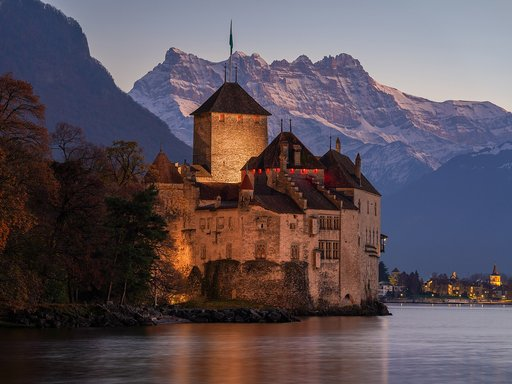

*The fitted picture, the reference every encoding below is measured
against.*

`zx scr encode` takes the same flags, so you can fit and encode in one
step. Fitting separately pays off when you encode the same picture
several times, or want the fitted picture to compare against.

A JPEG source decodes to within a level or so of what Pillow sees: `zx`
rebuilds JPEG colour with libjpeg-turbo's chroma interpolation. The
remaining differences come from the two decoders' inverse DCTs.

## Encoding in each palette

`--mode` and `--palette` select the specification's reference encoder.
For each 8x8 cell, it tries every pair of colours the attribute can name
and keeps the pair whose span covers the cell's pixels best. It then
dithers between the two colours in linear light, against an 8x8 Bayer
matrix. Its output is the specification's own, pixel for pixel.

```
zx scr encode chillon-fit.png --mode zxmode2 --palette zxpal0 -o chillon0.zm2
zx scr encode chillon-fit.png --mode zxmode2 --palette zxpal4 -o chillon4.zm2
zx scr decode chillon4.zm2 --palette zxpal4 -o chillon4.png
```

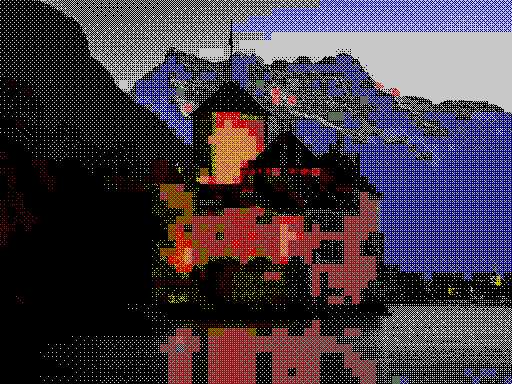

*ZXPAL0, the classic colours at 512x384. Each 8x8 cell has two colours
from eight hues, so the dusk blues come out as cyan and the warm stone
as yellow and red.*

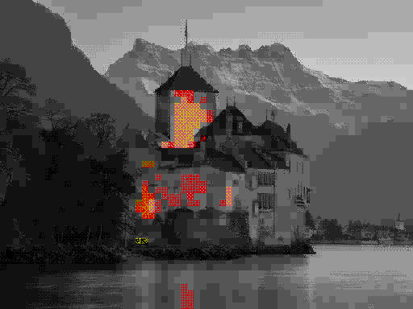

*ZXPAL1. Its grey banks carry the mountains, sky and lake; the colour
is left to the eight Spectrum hues, on the castle alone.*

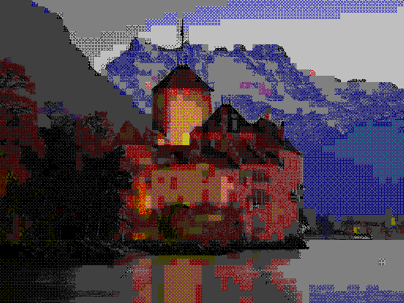

*ZXPAL2. The darker levels give the shadows a colour, but every colour
is still one of the eight hues.*

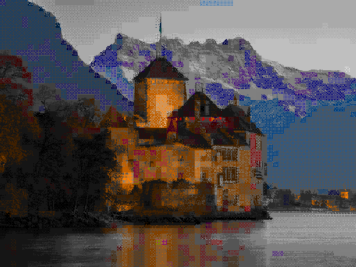

*ZXPAL3. With twelve hues and two independent registers per cell, orange
and azure appear for the first time.*

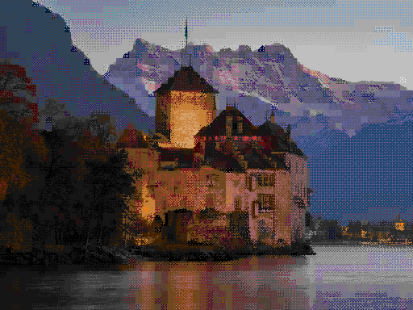

*ZXPAL4. The tones and tints add the muted colours of the dusk light.*

The two-byte palettes cost more memory: 30720 bytes for a ZXMODE2 screen
instead of 27648. They also take longer to encode. ZXPAL4 has nearly
6000 pairs to try per cell, and takes two to three seconds a screen.

## Measuring a result

`zx scr compare` counts the pixels where two pictures differ. That is
the right check for "did this come out identical?", but it says nothing
useful about how good a dithered picture is. `--metric` gives the
specification's measures instead:

```
$ zx scr compare --metric all chillon-fit.png chillon4.zm2 --palette zxpal4
error (blur 1.5)                 7.0337
lighter-blur error (blur 0.75)   9.5684
rms error                        22.9110
SSIM                             0.4147
```

| Metric | What it measures |
| --- | --- |
| `blur` | The specification's error: the RMS difference (0-255) after a Gaussian blur of 1.5 pixels on each channel. The blur stands in for the eye merging a dither at viewing distance, so a well-dithered colour scores as the colour it averages to. |
| `light` | The same with a blur of 0.75, which keeps more fine detail. |
| `blur=<sigma>` | Any other blur. |
| `rms` | No blur, so every dither dot counts as an error. |
| `ssim` | Structural similarity, computed as scikit-image computes it. |

All of them match the specification's Python tools to many decimal
places. The Chillon picture in each palette:

| Palette | `blur` | `light` | `ssim` | the specification's `blur` |
| --- | --- | --- | --- | --- |
| ZXPAL0 | 32.72 | 37.02 | 0.103 | 32.73 |
| ZXPAL1 | 16.34 | 17.71 | 0.633 | 16.35 |
| ZXPAL2 | 17.89 | 20.90 | 0.366 | 17.89 |
| ZXPAL3 | 10.72 | 13.25 | 0.415 | 10.73 |
| ZXPAL4 | 7.03 | 9.57 | 0.415 | 7.04 |

The last column comes from the specification's `data/results_by_palette.csv`.
The small differences come from JPEG decoding, described under
[reproducing the specification's results](#reproducing-the-specifications-results).

SSIM ranks ZXPAL1 above ZXPAL4, although ZXPAL4 is plainly the closer
picture. SSIM rewards matching local contrast and structure, and
ZXPAL1's smooth greys match the photograph's light and dark well while
getting most of its colour wrong. The blurred error measures colour as well, and
is the one the specification's conclusions rest on. Use both when you
compare encoders, and look at the pictures.

Either side of `compare` can be a screen file. A 256x192 picture is
doubled to compare it with a 512x384 one, as ZXMODE1 appears on the
ZXMODE2 raster.

## Loaded registers

ZXPAL's palette registers are loadable (Part 5 of the specification). A
program can overwrite them, and the same screen bytes then show other
colours. `--registers file.csv` tells `zx` which colours a screen is
meant for, when encoding, decoding, and in every other command that
reads a screen.

`zx scr palette` writes a palette's reset values as a starting point:

```
$ zx scr palette zxpal2
ZXPAL2: 32 registers, attribute one byte
  0  000000    0   0   0
  1  000040    0   0  64
  2  400000   64   0   0
...
zx scr palette zxpal2 -o zxpal2.csv
```

The CSV has a header and one row per register: `register,hex,r,g,b`. Edit
the colours and keep the register numbers. As an example, here is ZXPAL2
with each register replaced by a sepia tone of the same brightness (its
ITU-R 601 luminance times 1.08, 0.86 and 0.62 for red, green and blue),
the kind of palette a game might load for a flashback:

```
zx scr encode chillon-fit.png --mode zxmode2 --palette zxpal2 --registers sepia.csv -o sepia.zm2
zx scr decode sepia.zm2 --palette zxpal2 --registers sepia.csv -o sepia.png
```

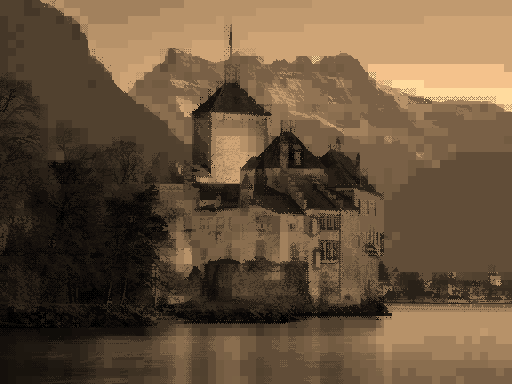

*Encoded for the sepia registers. The encoder chooses among the colours
the registers will show, so the dusk blues become the nearest sepia
tones.*

The same `sepia.zm2` decoded without `--registers` shows the reset
colours, and looks wrong. The file doesn't know which colours it was
encoded for, so keep the register table with it. A ZCUT collection does
keep it (see the next section). The specification's
`data/zxpalN_registers.csv` files read as register tables as they are.

## Assets across palettes

`cut`, `paste`, `flip` and `convert` work on ZXMODE screens in any
palette. A ZCUT `.cut` collection records each attributed asset's
palette, which fixes how its attributes are stored. When an asset was
cut from a screen with loaded registers, the collection also records
its register table.

| ZCUT version | Holds |
| --- | --- |
| 1 | ZXPAL0 assets only, the original format |
| 2 | adds each asset's palette, and two-byte attributes for ZXPAL3 and ZXPAL4 |
| 3 | adds a register table per asset |

A collection is written at the lowest version that holds it, so
collections of classic assets stay version 1.

Cut the castle's keep from the ZXPAL4 screen, mirror it, and paste both
copies into a classic screen:

```
$ zx scr cut chillon4.zm2 --palette zxpal4 --cells 23,2,12,22 --name keep -o parts.cut
cut "keep" (96x176, color ZXPAL4) -> parts.cut [1 assets]
$ zx scr flip parts.cut --name keep -h -o mirrored.cut
$ zx scr paste parts.cut:keep blank.scr --at 24,8 --op copy -o scene.scr
pasted "keep" at 24,8 -> scene.scr (attributes converted from ZXPAL4 to ZXPAL0)
$ zx scr paste mirrored.cut:keep scene.scr --at 136,8 --op copy
```

Here `blank.scr` is any classic screen, in this case 6912 zero bytes
(`head -c 6912 /dev/zero > blank.scr`).

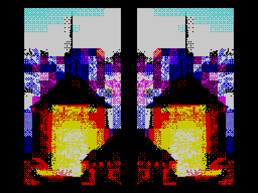

*The keep, converted to ZXPAL0 and pasted twice (shown at double size).
The conversion maps each cell's two ZXPAL4 colours to the nearest
Spectrum pair, so the dusk light turns into bright primaries.*

When an asset's palette or registers differ from the target screen's,
`paste` converts the attributes and says so. Conversion keeps the bitmap
exactly. Each cell takes the target colours nearest to its own ink and
paper, weighted by how many of the cell's pixels each one covers. In a
one-byte palette, ink and paper must share a bank, so the best bank
wins. A colour the target holds exactly is kept exactly. Flash survives
only from ZXPAL0 to ZXPAL0.

`zx scr convert` does the same conversion on its own, for a collection,
one asset (`--name`) or a whole screen. `--to-mode` can also move a
screen between ZXMODE0 and ZXMODE1, which are the same size.

```
zx scr convert parts.cut --to zxpal1 -o parts1.cut
zx scr convert chillon4.zm2 --palette zxpal4 --to zxpal0 -o chillon4-as-0.zm2
```

Converting is not re-encoding. The bitmap was dithered for ZXPAL4's
colours, and a cell can only swap its two colours for others. Converting
the ZXPAL4 Chillon to ZXPAL0 scores 45.13, against 32.72 for encoding
the picture in ZXPAL0 directly. Convert assets when the picture is gone, or
when the pixels must stay as drawn. Re-encode when you still have the
source picture.

## Text and sprites on ZXMODE screens

`zx scr ocr` reads text from ZXMODE screens as well as classic ones. A
classic `.scr` in ZXPAL0 is read by colour, as before. A `.zm1` or `.zm2`
is read from its bitmap: 24 lines of 32 characters in ZXMODE1, and 48 of
64 in ZXMODE2. A cell with more ink than paper is read inverted, so
inverse video reads too. A classic text screen converted to ZXMODE1
reads the same as the original:

```
zx scr convert text.scr --to zxpal0 --to-mode zxmode1 -o text.zm1
zx scr ocr text.zm1
```

`zx scr crop --auto` finds the box around a screen's set bitmap bits,
whatever the mode:

```
$ zx scr crop scene.scr --auto -o keeps.png
wrote keeps.png (208x176 at 24,8)
```

## Better encodings

Part 4 of the specification lists ways an encoder might improve on the
reference one, untested there. `zx` has three of them as options. Each
leaves the reference encoder, so the output is no longer the
specification's picture.

| Flag | Effect |
| --- | --- |
| `--diffuse f` | Spreads each cell's colour error, times f (0 to 1), into the cells not yet encoded, as Floyd-Steinberg spreads a pixel's error. The encoder then runs on one CPU. |
| `--flat n` | Fills cells whose pixels vary less than n with a single colour instead of a dither. |
| `--linear-pairs` | Chooses each cell's pair by distance in linear light rather than sRGB. |

Error diffusion is the one that works. On the specification's 22 colour
pictures, half diffusion lowered the mean error from 31.20 to 22.57 in
ZXPAL0, from 20.79 to 17.35 in ZXPAL2, and from 8.67 to 7.55 in ZXPAL4.
`--flat` and `--linear-pairs` made it worse on every palette (the CLI
manual has the full table). For Chillon:

```
zx scr encode chillon-fit.png --mode zxmode2 --palette zxpal0 --diffuse 0.5 -o chillon0d.zm2
```

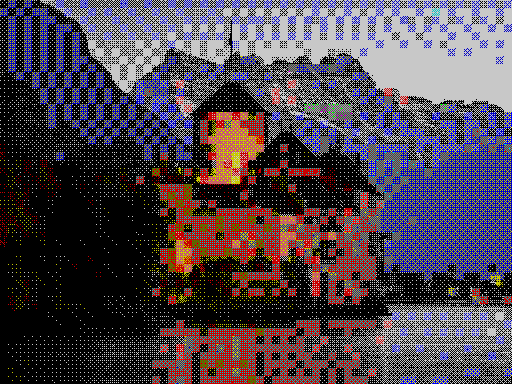

*ZXPAL0 with `--diffuse 0.5`: error 22.99, against 32.72 for the
reference encoder. A cell that can't reach a colour passes the shortfall
on to its neighbours, so areas average closer to the photograph.*

In ZXPAL4, the same flag takes Chillon from 7.03 to 6.12. The output
is an ordinary screen, so nothing downstream changes.

`--penalty p` adjusts the reference encoder itself. Each pair's score
adds a penalty on the distance between its two colours, so that a cell
prefers close colours over a wide dither. The reference weight is 0.204.
For Chillon in ZXPAL2, 0.1 gives 19.30 and 0.4 gives 20.10, against
17.89 at the reference weight. The output is still a screen.

## Designing palettes

The specification chose its palettes by encoding pictures with candidate
colour sets and measuring the result. `zx` can run the same kind of
experiment. The output is then a PNG to look at and measure, not a
screen, because no ZXMODE file holds these colours or cell sizes.

**Colour banks.** `--banks file.csv` encodes over any colours instead of
a palette's. The file has one row per colour, with columns `bank`, `r`,
`g` and `b` (or `hex`), and each cell takes its two colours from one
bank. Without a `bank` column, every colour is in one bank, which is how
ZXPAL3 and ZXPAL4 work. `zx scr palette --banks` writes a palette's banks
in the order the encoder uses, as a starting point. Encoding over that
file gives the palette's own encoding, pixel for pixel.

```
zx scr palette zxpal2 --banks -o zxpal2-banks.csv
zx scr encode chillon-fit.png --mode zxmode2 --banks zxpal2-banks.csv -o check.png
```

**Cell sizes.** `--cell WxH` encodes with cells of another size, which
must divide the picture. `--cell 4` means 4x4. A 4x4 cell dithers against
the 4x4 Bayer matrix. Other sizes dither against the 8x8 matrix laid over
the whole picture, as the specification's tools do.

```
zx scr encode chillon-fit.png --mode zxmode2 --palette zxpal2 --cell 4 -o chillon2-c4.png
```

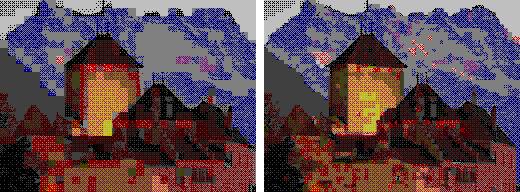

*ZXPAL2 with 8x8 cells (left, error 17.89) and 4x4 cells (right, 15.63).
Smaller cells need four times the attribute memory, which is why the
specification keeps 8x8.*

**Fitting colours to pictures.** `zx scr fitregs` is the specification's
register search. It adds `--add n` colours to ZXPAL3, ZXPAL4 or a
one-bank table, chosen so that the pixels of the given pictures lie
nearer to some colour:

1. It blurs each picture and samples its pixels.
2. It picks new colours one at a time from candidates drawn from the
   sample, each time the one that most reduces the squared distance to
   the nearest colour.
3. It refines the new colours by k-means, with the base colours fixed.

It writes the base and the new colours as one bank, for `encode
--banks`:

```
$ zx scr fitregs --palette zxpal3 --add 16 -o zxpal3-16.csv melons.png moravian.png tunisian.png runner.png uzbek.png
wrote zxpal3-16.csv (80 colours: 64 + 16 fitted to 5 picture(s))
sample distance to the nearest colour: mean 33.60 -> 17.52, share over 50: 0.227 -> 0.008
$ zx scr encode chillon-fit.png --mode zxmode2 --banks zxpal3-16.csv -o chillon3-16.png
```

The pictures are used as they are, so fit them first with `zx scr fit`.
Colours fitted to a picture flatter that picture, so test on pictures
the colours were not fitted to, as here: Chillon is not among the five.

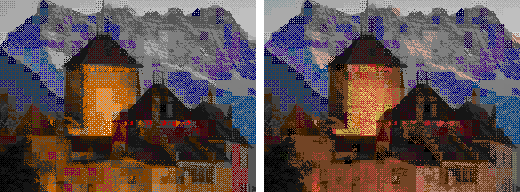

*ZXPAL3 (left, error 10.72) and ZXPAL3 plus 16 colours fitted to five
other pictures (right, 9.39). The fitted colours are the muted ones a
rule-built hue wheel lacks.*

Run as the specification ran it, on its ten development pictures in two
folds of five, with each fold encoded using colours fitted to the other:

| Colours | ZXPAL3 | +8 | +16 | +32 | +48 |
| --- | --- | --- | --- | --- | --- |
| `zx scr fitregs` | 13.16 | 10.14 | 9.23 | 8.58 | 7.95 |
| the specification (Part 3, section 17) | 13.16 | 10.28 | 9.42 | 8.47 | 7.91 |

This is the finding behind ZXPAL4. Fitted colours showed which muted
colours were missing, and ZXPAL4 adds such colours by rule rather than
from data. `fitregs` makes its random draws from a fixed seed
(`--seed`), so a fit repeats exactly. Its colours differ from those of
the specification's Python script, which draws differently.

## Reproducing the specification's results

With `fit`, `encode` and `compare`, `zx` can recompute the
specification's results table, `data/results_by_palette.csv`, without
Python. For each picture, fit it as `pictures/README.md` says (trim and
centring), add `--grey` for the grey half of the table, encode it in
each palette, and measure:

```
zx scr fit melons.jpg --resize fill --filter lanczos --centering 0.5,0.7 -o melons-fit.png
zx scr encode melons-fit.png --mode zxmode2 --palette zxpal3 -o melons3.zm2
zx scr compare --metric blur melons-fit.png melons3.zm2 --palette zxpal3
```

Over the whole table (44 pictures, colour and grey, five palettes),
118 of the 220 values come out equal to two decimals, and none differs
by more than 0.03. The fit, the encoder and the error measure are exact.
The remaining difference is JPEG decoding: Go's decoder and
libjpeg-turbo round a few per cent of their inverse-DCT values 1 to 3
levels apart. The register tracks this as T-08. From PNG copies of the
same pixels, the fit and the encodings match byte for byte.

## Reference notes

All the commands here are `zx scr` subcommands. The full flag reference
is in the [CLI manual](CLI.md#zx-scr), and the library API in the
[library manual](LIBRARY.md#zxmode-pictures-and-zxpal-palettes). Points
that are easy to miss:

- **A screen file does not record its palette or registers.** Decoding
  with the wrong `--palette` gives a wrong picture, not an error,
  whenever the sizes agree (ZXPAL0, ZXPAL1 and ZXPAL2 share a size, as
  do ZXPAL3 and ZXPAL4). Keep the palette in the file name, or keep the
  picture in a `.cut` collection, which records both.
- **The classic converter is still there.** `zx scr encode` without
  `--mode`, `--palette` or `--registers` works as it always has: it
  posterises first, which turns normal colours into bright ones. With
  `--palette zxpal0`, the reference encoder keeps both.
- **The encoder options don't mix with design experiments.**
  `--diffuse`, `--flat` and `--linear-pairs` work on 8x8 cells of a real
  palette, so they are refused with `--banks` or `--cell`. `--penalty`
  works with both.
- **ZXPAL4's pair order.** The reference encoder lists ZXPAL4's colours
  in ascending RGB order, and `palette --banks` writes them in that
  order, so encoding over the written file reproduces the palette
  exactly. A register table (`palette -o`) is in register order instead.
  Read as banks, it gives one bank in that order, so the rare tied cell
  can resolve differently.
